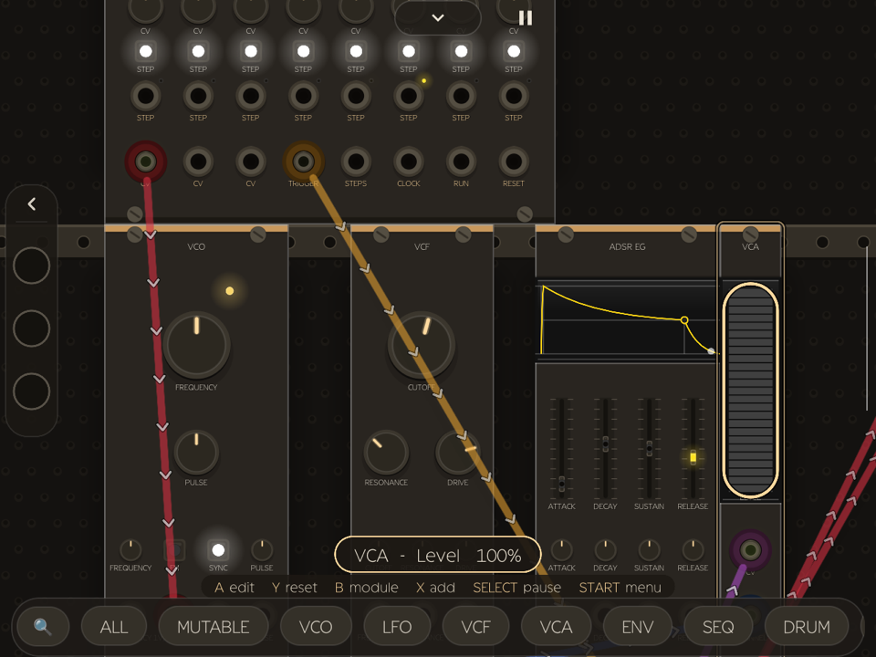
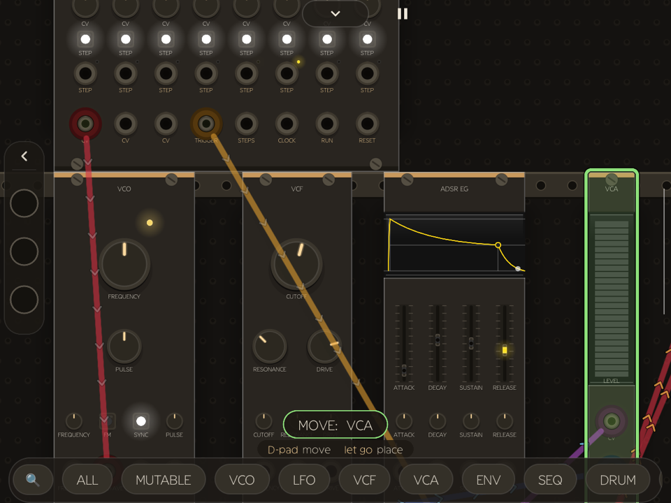
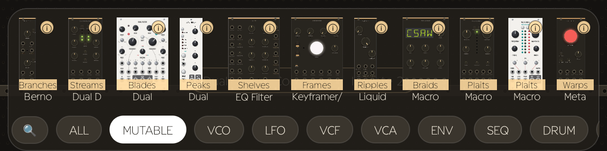
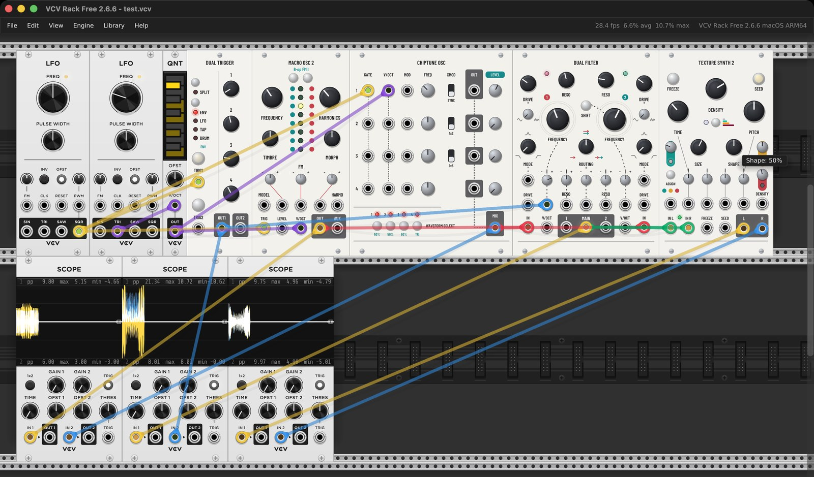

# RackDroid for Retroid Pocket Nova

[RackDroid](https://github.com/nowheel/RackDroid)（VCV Rack 2 の Android 移植）を、ゲームパッド付きの携帯機 **Retroid Pocket Nova** で、画面に触れずに使えるようにした fork です。

本家はタッチ専用です。4.5 インチの画面では、画面を動かすつもりの指がモジュールやつまみを動かしてしまいます。この fork は、十字キーでつまみやジャックを選び、ボタンで編集・配線・モジュールの追加と移動ができるようにしました。スティック・本体の傾き・タッチパッドを、パッチの中の電圧（CV）として使うこともできます。

VCV の Audible Instruments にない Mutable Instruments 系のモジュール 5 つ（Beads、Peaks、Edges、Blades、24 モデル版の Plaits）も足してあります。同じモジュールを Mac の VCV Rack 2 にも入れられるので、それを使ったパッチも両方で開けます。

タッチ操作など本家の機能はそのまま残してあります。パッチは VCV Rack 2 と同じ `.vcv` です。Nova に入るアプリの名前は「RackDroid Nova」です。

- 本家：`nowheel/RackDroid`（GPLv3）。この fork も GPLv3 です。本家・VCV とは無関係の非公式な改造です。
- 開発の記録：[docs/status.md](docs/status.md)、計画：[docs/plan.md](docs/plan.md)

## 操作


ボタンの割り当て。青は画面の移動、茶は操作、緑は演奏（CV）。

十字キーを押すと、いちばん近いつまみかジャックに**フォーカスの輪**が付きます。画面下には「モジュール名 - つまみ名　値」が出ます。フォーカス中のつまみが属するモジュールには、薄い枠が付きます。



フォーカスの輪（つまみ）と、そのモジュールを示す薄い枠。画面下に名前と値。

| ボタン | フォーカスが… | 動作 |
|---|---|---|
| 十字キー | — | 近くのつまみ・ジャックへ移動。モジュールの端では隣のモジュールへ |
| A | つまみ | 編集モード。↑↓ で粗く、←→ で細かく。A か B で終了 |
| A | スイッチ・ボタン | 切り替え。押している間だけ効くボタンは、A を押している間だけオン |
| A | ジャック | ケーブルを始める。つなげられるジャックだけを移動でき、行き先で A を押すと接続 |
| A | つまみのないモジュール | そのモジュールを持ち上げる（移動） |
| B | — | 戻る。編集の終了、配線の取消、どちらでもなければフォーカスを消す |
| Y | つまみ / ジャック | つまみを初期値に戻す / ジャックのケーブルを抜く |
| X | — | モジュールを追加 |
| 右スティック | つまみ | 直接回す（上下で大きく、左右で細かく） |
| 左スティック | — | 画面の移動（パン） |
| L2 / R2 | — | 縮小 / 拡大 |
| Select | — | ズームの切替（等倍 → 2 倍 → 全体） |
| Start | — | メインメニュー |

値の変更、配線、モジュールの移動は、Undo で取り消せます。フォーカスを消したあとは、B 以外のボタンを押すと同じ場所に戻ります（最初の一押しは戻すだけです）。

## メニュー

Start でメインメニュー、X でモジュールの追加が開きます。十字キーで選び、A で決定、B で戻る、L1 / R1 でページ送りです。


メインメニュー。ツールバーやモジュールパレットはタッチ専用なので、同じ機能へここから行けるようにしてあります。

| 項目 | 内容 |
|---|---|
| Add module… | 種類（MUTABLE、VCO、LFO、VCF …）を選び、一覧からモジュールを選ぶ |
| Move module | フォーカス中のモジュールを移動する |
| Module menu… | フォーカス中のモジュールのメニュー（初期化、複製、削除、バイパス、プリセット） |
| XY pad | タッチパッドを出す・しまう |
| Undo / Redo | 取り消し / やり直し |
| File… / Edit… / View… / Engine… / Help… | 本家のメニュー（保存、開く、表示設定など） |
| Tools… | ツールバーのアイコンと同じ機能（鍵盤、録音、MIDI、ロックなど） |

## モジュールを動かす

**L1 か R1 を押したまま十字キー**を押すと、フォーカス中のモジュールが動きます。離すと確定です。



移動中のモジュールは緑の枠で囲まれます。

- 左右：隣のモジュールと場所を入れ替える。隣が空いていれば、その方向へ進む
- 上下：上・下の段へ移す。移った先のモジュールが場所を空ける

X で追加した直後のモジュールは、最初から移動モードになっています。十字キーで置き場所を決めて A で確定、B で元の場所に戻します。メインメニューの「Move module」からも同じモードに入れます。

## 演奏：スティック・傾き・タッチパッドを CV に

VCV Rack 標準の「Gamepad」MIDI ドライバとして見えるので、専用のモジュールは要りません。**MIDI CC to CV** モジュールを置き、入力元に「Gamepad」→「Built-in controller」を選び、出力に下の番号を割り当てて、ケーブルでつなぎます。

| CC | 入力 | 電圧 | 使える条件 |
|---|---|---|---|
| 2 / 3 | 右スティックの左右 / 上下 | ±10 V（右・上が正） | 演奏モード |
| 15 | L3（左スティックの押し込み） | 0 / 10 V | 演奏モード |
| 21 / 22 | 本体の傾き：左右 / 前後 | ±10 V（右を下げる・奥へ倒すが正。35 度で最大） | 演奏モード |
| 23 / 24 | タッチパッドの X / Y | 0〜10 V（左→右、下→上） | パッドが出ている間 |
| 25 | タッチパッドに触れている | 0 / 10 V | パッドが出ている間 |

**演奏モード**は R3（右スティックの押し込み）で切り替えます。画面右上に緑の「PLAY」が出ます。変わるのは右スティックだけで、左スティックのパン、L2 / R2 のズーム、十字キーと A / B での操作はそのまま使えます。演奏中につまみを動かすときは、A を押して十字キーで調整します。

傾きは、演奏モードに入ったときの持ち方が中心です。取り直すときは R3 を 2 回押します。


タッチパッド（Start →「XY pad」）。指を離すとゲートが切れ、X と Y は最後の位置を保ちます。

デモパッチが入っています（Start → File… → Open）。

| パッチ | 試せること |
|---|---|
| Nova 1 - Stick CV | R3 で演奏モードにして右スティックを倒す。左右でフィルター、上下で音程 |
| Nova 2 - Tilt CV | R3 で演奏モードにして本体を傾ける。左右でフィルター、前後で音程 |
| Nova 3 - XY Pad | タッチパッドに触れている間だけ音が出る。左右で音程、上下でフィルター |
| Nova 4 - Mutable | 足した 5 モジュールを全部使った自動演奏（次の節） |

## Mutable Instruments のモジュール

### どれが Mutable 由来かを一覧で見分ける

「Mutable Instruments」は商標なので、移植版は別の名前で並んでいます（Plaits は「Macro Oscillator 2」、Rings は「Resonator」など）。名前だけでは元のモジュールが分からないので、追加の一覧に元の名前を出すようにしました。


X →「MUTABLE」。入っているパック全部から、Mutable 由来のモジュールだけが元の名前の順に並びます。

- **コントローラーの一覧**（X）：いちばん上に「MUTABLE」の分類があります。行は「元の名前 · 移植版の名前」、その下にパックの名前です。ほかの分類（VCO、VCF など）では、Mutable 由来のモジュールの名前の下に「Mutable Instruments Plaits」のように出ます。
- **タッチ用のパレット**（画面下の帯）：「MUTABLE」のチップが増え、タイルの絵の下に元の名前の帯が付きます。



タッチ用のパレット。帯は MUTABLE 以外の分類（ALL や VCO など）でも付きます。

元の名前は、各モジュールの説明文（「Based on Mutable Instruments Plaits」など）から読み取っています。あとからパックを足しても、説明文にそう書いてあれば同じように出ます。

### 足した 5 モジュール（Nova Modular）

VCV の Audible Instruments（20 モジュール）にないものを、「Nova Modular」というプラグインとして同梱しました。別にパックを入れる必要はありません。


デモパッチ「Nova 4 - Mutable」を Nova で開いたところ。左から Peaks、Plaits、Edges、Blades、Beads にあたるモジュール。

| パネルの表示 | 元のモジュール | 中身 | メモ |
|---|---|---|---|
| MACRO OSC 2 | Plaits（ファームウェア 1.2） | 元のファームウェアの DSP | 24 モデル。パネル上の 2 つのボタンでモデルを送り、選んだモデルの名前がタイトルの下に出る。ポリフォニック（16 声まで） |
| TEXTURE SYNTH 2 | Beads | 元のファームウェアの DSP | 音声入力に何もつながないと、10 秒後にウェーブテーブルシンセになる（実機と同じ） |
| DUAL TRIGGER | Peaks | 元のファームウェアの DSP | エンベロープ、LFO、タップ LFO、ドラムなど 8 機能 |
| CHIPTUNE OSC | Edges | ファームウェアの再現 | 実機は 8 bit のマイコンとタイマーで鳴らすため、同じ計算と同じ表を使って作り直したもの |
| DUAL FILTER | Blades | 回路のデジタルモデル | 実機はアナログ回路 |

- **Plaits の 24 モデル**：左のボタンは緑のバンク、右のボタンは赤のバンクの中でモデルを送ります（元の 16 モデル）。後から足された 8 モデル（6 オペレーター FM、ウェーブテレイン、ストリングマシン、チップチューンなど。ランプは黄色）は、モジュールのメニューの「Model」で選ぶか、「Buttons step through all 24 models」をオンにしてボタンで順に送ります。
- **実機でボタンの長押しや同時押しで行う設定**は、モジュールのメニューにあります（フォーカスを当てて Start →「Module menu…」）。Peaks の機能（Function）、Beads の音質（Quality）、Edges の波形、Plaits の LPG の設定などです。
- **元になったもの**：5 モジュールとも [BrickRack](https://github.com/andrewfrangella/brickrack)（TrimUI Brick 用のモジュラーシンセ、GPLv3）の実装を、そのまま VCV Rack のモジュールとして動かしています。DSP は Émilie Gillet さんが公開している[ファームウェア](https://github.com/pichenettes/eurorack)（MIT、Edges は GPLv3）です。出典とライセンスは `plugin/THIRD_PARTY_NOTICES.md` にあります。

## Mac とパッチをやり取りする

パッチは Nova の `/sdcard/Android/data/org.rackdroid.test/files/Patches/` に入ります（本家はアプリの中にしまっていて、外から読めません）。USB でつなぎ、`tools/novasync` で送受信します。

```sh
nova/tools/novasync list                       # Nova にあるパッチ
nova/tools/novasync push "My Patch.vcv"        # Mac → Nova（すぐ File > Open に出る）
nova/tools/novasync pull "My Patch.vcv" out/   # Nova → Mac
nova/tools/novasync pull                       # 全部を ./patches-from-nova へ
nova/tools/novasync recordings                 # 録音した WAV を取り出す
```

Nova で保存したパッチは、デスクトップ版の VCV Rack 2 と同じ形式です。開く側に同じモジュール（プラグイン）が入っていれば、そのまま開けます。

- Nova で保存したパッチを Mac で開くと、Audio モジュールの出力先が未選択になります（保存されているのが Nova のオーディオ設定のため）。Audio モジュールでデバイスを選び直すと音が出ます。
- Audible Instruments のモジュールを使ったパッチを Mac で開くには、Mac の VCV Rack にも Audible Instruments が要ります（VCV Library から無料で入れられます。VCV のアカウントが必要です）。

### 足した 5 モジュールを Mac の VCV Rack にも入れる

「Nova Modular」は普通の VCV Rack 2 のプラグインとしてもビルドできます。Nova 用と同じソースです。

```sh
nova/tools/rack-sdk-from-repo.sh                                        # ビルドに使う Rack のヘッダーをそろえる
make -C nova/plugin RACK_DIR="$PWD/nova/downloads/rack-sdk" install     # ビルドして VCV Rack に入れる
```

`~/Library/Application Support/Rack2/plugins-mac-arm64/` に入り、次に VCV Rack を起動したときから「Nova Modular」のモジュールが使えます。1 行目のスクリプトは、このリポジトリにある Rack のソースと、Mac に入っている VCV Rack 2 から必要なものを集めます（先に Android 用のビルドを 1 回済ませておきます）。VCV が配っている Rack SDK を持っていれば、1 行目は要らず、`RACK_DIR` にその場所を指定します。



Mac の VCV Rack 2 で同じ 5 モジュールを動かしたところ。下の Scope は各モジュールの出力。

## ビルドと導入

Mac での手順です。Android Studio（同梱の JDK 21 を使う）と、Android SDK の NDK 27.2.12479018・CMake 3.22.1・API 35 が要ります。

```sh
export JAVA_HOME="/Applications/Android Studio.app/Contents/jbr/Contents/Home"
export ANDROID_HOME="$HOME/Library/Android/sdk"
./gradlew assembleSideloadRelease -PdevKeystore -PtestBuild
adb install -r app/build/outputs/apk/sideload/release/app-sideload-release.apk
```

`-PtestBuild` を付けると、アプリ ID が `org.rackdroid.test`（表示名「RackDroid Nova」）になり、公式版と並べて入ります。モジュールパック（`.rdmod`、本家のリリースにあります）は `/sdcard/Android/data/org.rackdroid.test/files/Modules/` に置いて再起動します。

## わかっていること・まだのこと

- Nova（Android 13）でだけ確かめています。ほかのゲームパッドは、十字キーがキーでも軸でも届くように作ってありますが、試していません。
- 音の遅れは Nova で合計およそ 50 ms です（本家と同じ。Nova が最速のオーディオ経路を許可しないため）。
- 傾きの向きと効き具合は、いまの設定でいったん確定しています（細かい調整はしていません）。
- MIDI（USB キーボード、外部機器、Mac の DAW、Bluetooth）は本家の機能のままで、この fork では機材がなく確かめていません。
- 足した 5 モジュールは、Mac 上の検証（`nova/plugin/test/run.sh`：Plaits の 24 モデルが全部鳴ること、音程が 1 V/oct に合うこと、Peaks のエンベロープ、Blades のフィルター、Beads のグレインとシンセ）と、Nova での録音で確かめています。実機のモジュールとの聴き比べはしていません。元にした BrickRack も v0.1 です。
- 足した 5 モジュールのうち、ポリフォニックなのは MACRO OSC 2 だけです。
- 改造の中心は `native/port/gamepad_*.cpp` と `app/src/main/java/org/rackdroid/{GamepadMenu,TiltSensor,XyPad,MutableOrigin}.kt`、足したモジュールは `nova/plugin/` です。VCV Rack 本体（`third_party/`）には手を入れていません。
