# RackDroid for Retroid Pocket Nova

[RackDroid](https://github.com/nowheel/RackDroid)（VCV Rack 2 の Android 移植）を、ゲームパッド付きの携帯機 **Retroid Pocket Nova** で、画面に触れずに使えるようにした fork です。

本家はタッチ専用です。4.5 インチの画面では、画面を動かすつもりの指がモジュールやつまみを動かしてしまいます。この fork は、十字キーでつまみやジャックを選び、ボタンで編集・配線・モジュールの追加と移動ができるようにしました。スティック・本体の傾き・タッチパッドを、パッチの中の電圧（CV）として使うこともできます。

「ゆっくりしたエコーを足して」のように、**チャットでパッチを組む**こともできます。答えるのは、Nova の中で動く Claude Code です。

VCV の Audible Instruments にない Mutable Instruments 系のモジュール 5 つ（Beads、Peaks、Edges、Blades、24 モデル版の Plaits）も足してあります。同じモジュールを Mac の VCV Rack 2 にも入れられるので、それを使ったパッチも両方で開けます。

タッチ操作など本家の機能はそのまま残してあります。パッチは VCV Rack 2 と同じ `.vcv` です。Nova に入るアプリの名前は「RackDroid Nova」です。

- 本家：`nowheel/RackDroid`（GPLv3）。この fork も GPLv3 です。本家・VCV とは無関係の非公式な改造です。
- 開発の記録：[docs/status.md](docs/status.md)、計画：[docs/plan.md](docs/plan.md)

## 操作

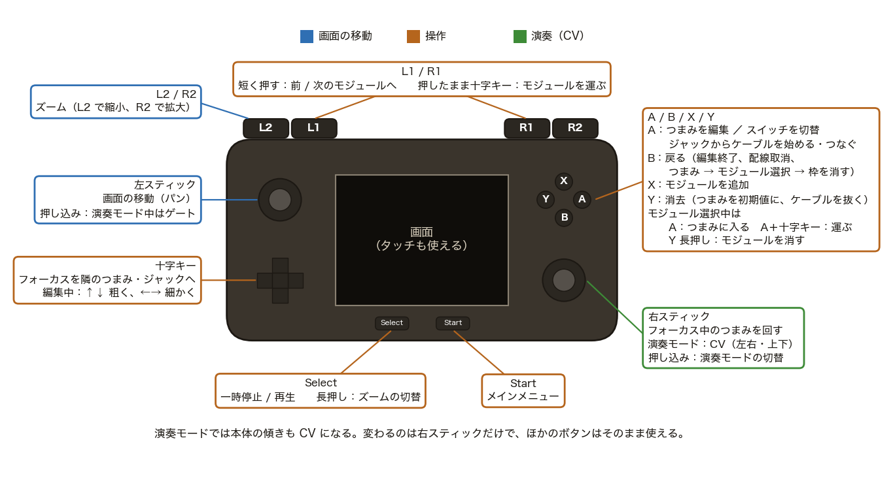

ボタンの割り当て。青は画面の移動、茶は操作、緑は演奏（CV）。

十字キーを押すと、いちばん近いつまみかジャックに**フォーカスの輪**が付きます。画面下には「モジュール名 - つまみ名　値」が出ます。フォーカス中のつまみが属するモジュールには、薄い枠が付きます。


フォーカスの輪（つまみ）と、そのモジュールを示す薄い枠。画面下に名前と値、その下に**いまの場所でボタンが何をするか**が出ます。

| ボタン | フォーカスが… | 動作 |
|---|---|---|
| 十字キー | — | 近くのつまみ・ジャックへ移動。モジュールの端では隣のモジュールへ |
| A | つまみ | 編集モード。↑↓ で粗く、←→ で細かく。A か B で終了 |
| A | スイッチ・ボタン | 切り替え。押している間だけ効くボタンは、A を押している間だけオン |
| A | ジャック | ケーブルを始める。つなげられるジャックだけを移動でき、行き先で A を押すと接続 |
| A | つまみのないモジュール | そのモジュールを持ち上げる（移動） |
| B | — | 戻る。編集の終了、配線の取消、どちらでもなければ**モジュール選択**へ（次の節）。もう一度でフォーカスを消す |
| Y | つまみ / ジャック | つまみを初期値に戻す / ジャックのケーブルを抜く |
| X | — | モジュールを追加 |
| 右スティック | つまみ | 直接回す（上下で大きく、左右で細かく） |
| 左スティック | — | 画面の移動（パン） |
| L2 / R2 | — | 縮小 / 拡大 |
| Select | — | 短く：一時停止 / 再生。長押し：ズームの切替（等倍 → 2 倍 → 全体） |
| Start | — | メインメニュー |

値の変更、配線、モジュールの移動と削除は、Undo で取り消せます。フォーカスを消したあとは、B 以外のボタンを押すと同じ場所に戻ります（最初の一押しは戻すだけです）。ツールバーの南京錠をかけると、コントローラーの操作も同じように止まります。

## モジュールを選ぶ・動かす・消す

つまみにいるときに **B** を押すと、つまみからモジュールへ 1 段上がり、パネル全体が太い枠で囲まれます。

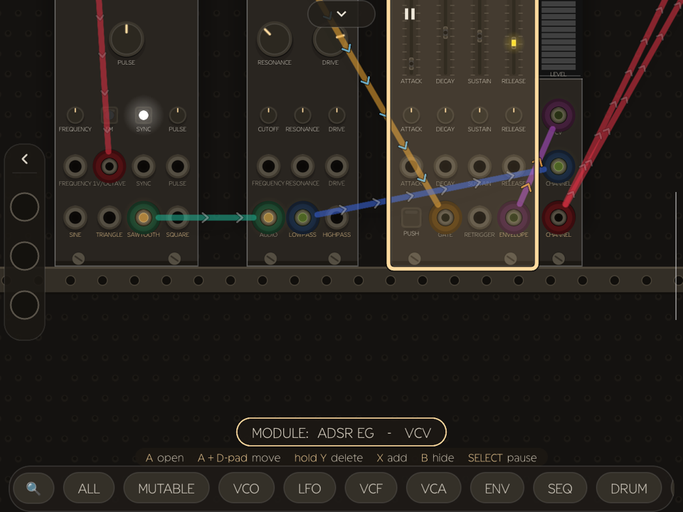

モジュール選択。このモジュールに入るケーブルの矢印は青、出ていくケーブルの矢印は橙になります。

| ボタン | 動作 |
|---|---|
| 十字キー | 隣のモジュールを選ぶ（左右は同じ段、上下は別の段） |
| A（短く） | つまみに入る（前にいたつまみへ戻る） |
| **A を押したまま十字キー** | モジュールを動かす。離すと確定 |
| **Y を 0.5 秒押し続ける** | モジュールを消す。赤が満ちきる前に離せば消えない |
| X | モジュールを追加 |
| B | 枠を消す |

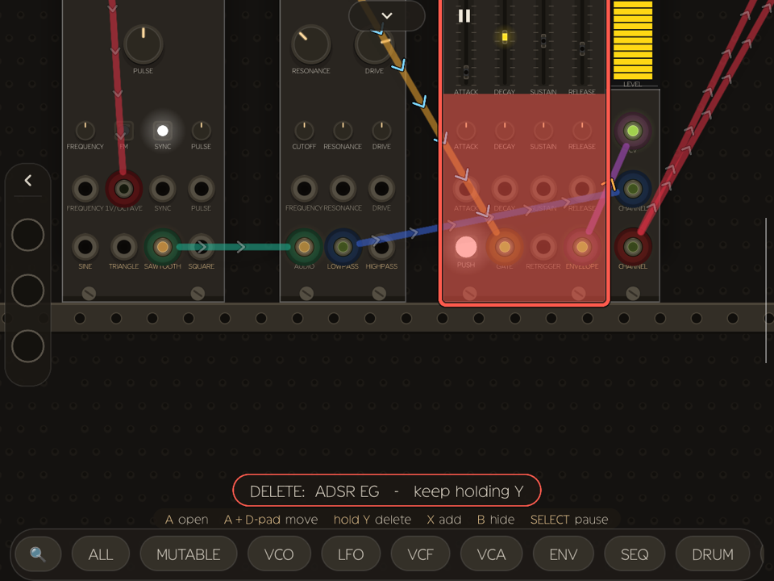

Y を押している間、下から赤が満ちていきます。消したあとは隣のモジュールが選ばれるので、続けて消せます。ケーブルごと Undo 1 回で戻ります。

動かすのは、つまみにいるときでもできます。**L1 か R1 を押したまま十字キー**です。


移動中のモジュールは緑の枠で囲まれます。

- 左右：隣のモジュールと場所を入れ替える。隣が空いていれば、その方向へ進む
- 上下：上・下の段へ移す。移った先のモジュールが場所を空ける

X で追加した直後のモジュールは、最初から移動モードになっています。十字キーで置き場所を決めて A で確定、B で元の場所に戻します。メインメニューの「Move module」「Delete module」からもできます。

## 一時停止と再生

**Select** を短く押すと止まり、もう一度押すと続きから鳴ります。音を消すのではなくエンジンごと止めるので、シーケンサーもエンベロープもディレイも、止めた所から進みます。

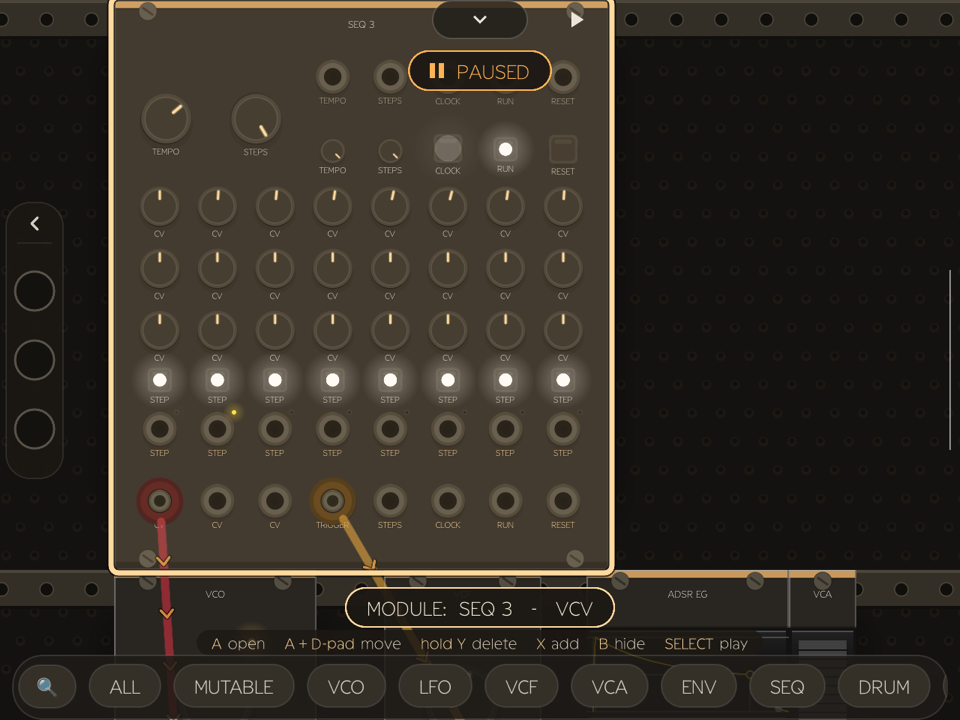

停止中は「PAUSED」が出ます。Start メニューの先頭の「Pause / Play」と、ツールバーの折りたたみ矢印の右のボタン（タッチ用）でも切り替えられます。録音中に止めると、録音もその間は止まります。パッチを開くと再生に戻ります。

## 音の流れ

ケーブルの上を、出力から入力へ矢印が流れます。

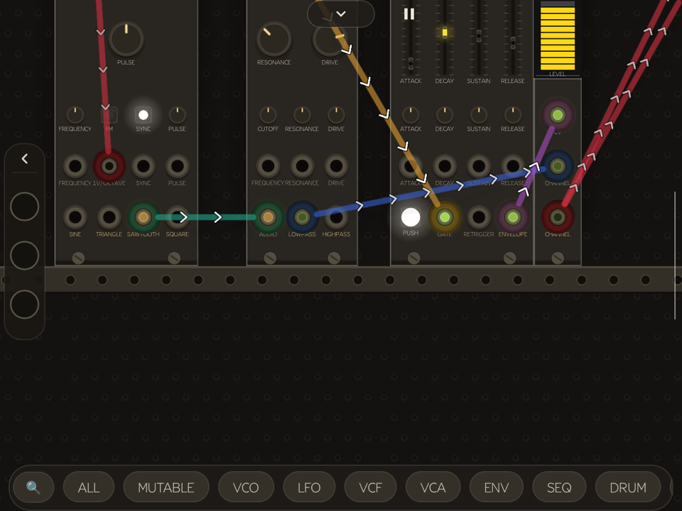

- 矢印の向きが信号の向きです。止まった画面でも読めます。
- 強い信号ほど、矢印が濃く大きくなります。何も出していない出力のケーブルでは、薄い矢印が止まっています。
- モジュールを選んでいる間は、入ってくるケーブルが青、出ていくケーブルが橙になり、ほかは薄くなります。ジャックにフォーカスしている間は、そのジャックのケーブルに色が付きます。
- Start →「Signal flow: on / off」で消せます。

## メニュー

Start でメインメニュー、X でモジュールの追加が開きます。十字キーで選び、A で決定、B で 1 つ前に戻る、L1 / R1 でページ送りです。


メインメニュー。ツールバーやモジュールパレットはタッチ専用なので、同じ機能へここから行けるようにしてあります。

| 項目 | 内容 |
|---|---|
| Pause / Play | 一時停止 / 再生 |
| Chat… | チャットでパッチを変える（「チャットでパッチを組む」の節） |
| Add module… | 検索、タグ、種類（MUTABLE、VCO、LFO、VCF …）からモジュールを選ぶ（次の節） |
| Move module | フォーカス中のモジュールを移動する |
| Module menu… | フォーカス中のモジュールのメニュー（初期化、複製、削除、バイパス、プリセット） |
| Tags of this module… | フォーカス中のモジュールにタグを付ける |
| Delete module | フォーカス中のモジュールを消す |
| XY pad | タッチパッドを出す・しまう |
| Signal flow | 音の流れの矢印を出す・消す |
| Undo / Redo | 取り消し / やり直し |
| File… / Edit… / View… / Engine… / Help… | 本家のメニュー（保存、開く、表示設定など） |
| Tools… | ツールバーのアイコンと同じ機能（鍵盤、録音、MIDI、ロックなど） |

## モジュールを探す：検索とタグ

X で開く一覧の先頭に、**Search…** と **Tags…** があります。

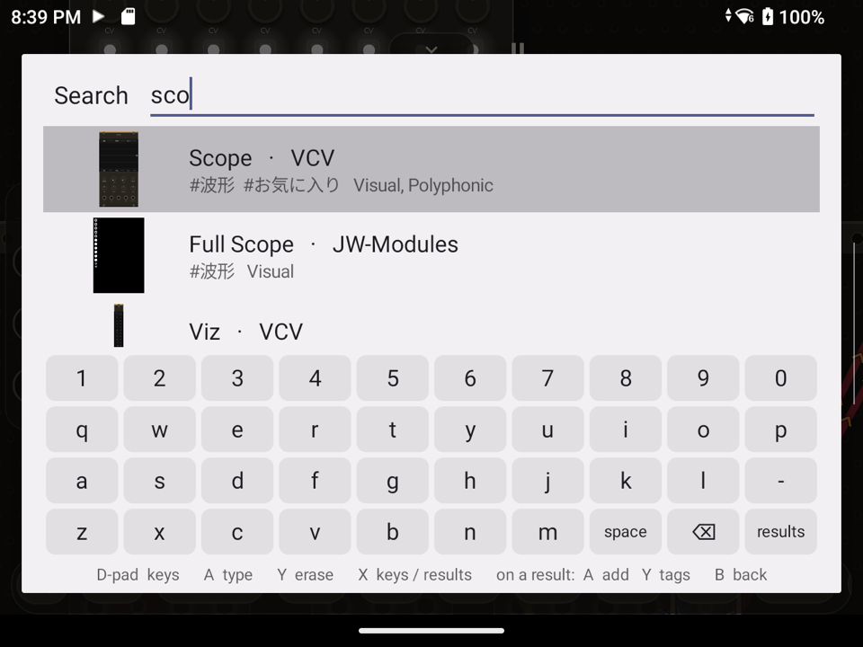

**検索**は、十字キーで文字を選んで A で打ちます（Y で 1 字消す）。↑ でキーボードの上端を越えるか X を押すと結果へ移り、A で追加します。入力欄に触れると Android のキーボード（Gboard など）が出て、日本語も打てます。

探せるのは、名前、メーカー、Mutable の元の名前、説明文、タグです。Rack に元からあるタグ（Visual、Filter など 57 個）は、日本語や別の言い方でも当たります。たとえば「波形」「可視化」「オシロ」「scope」「meter」のどれでも、波を見るモジュール（Scope）が先頭に出ます。空白で区切って語を並べると、全部に当たるものだけになります。

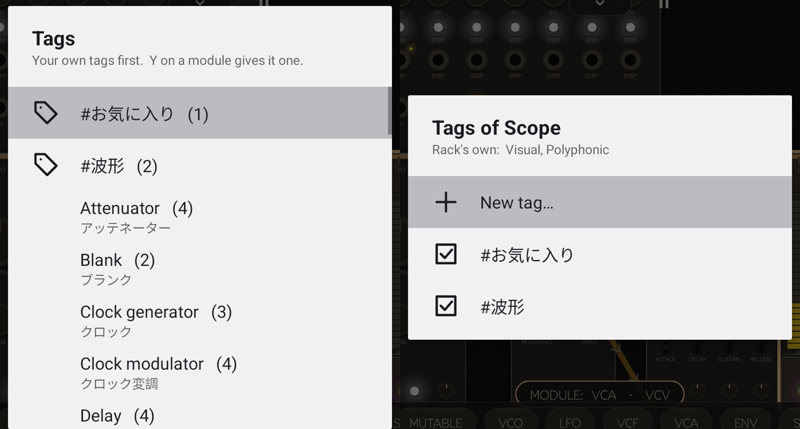

**タグ**は自分で付けられます。一覧や検索結果のモジュールで **Y** を押すと、付け外しの画面（右）になります。置いてあるモジュールには、Start →「Tags of this module…」で付けます。付けたタグは一覧のモジュール名の下に「#タグ」と出て、検索に当たり、「Tags…」（左）の先頭にも並びます。

タグはモジュールの種類ごとに付きます（パッチには入りません）。Nova の `/sdcard/Android/data/org.rackdroid.test/files/module-tags.json` に保存され、`tools/novasync tags` で Mac に取り出せます。

分類には、波形やメーターを見るモジュールを集めた **VISUAL** を足しました。タッチ用パレットの検索も、同じ探し方になっています。

## チャットでパッチを組む

Start →「Chat…」か、ツールバーの折りたたみ矢印の左の吹き出しで、画面の右にチャットが出ます。してほしいことを書くと、モジュールの追加、配線、つまみの設定をその場で行います。日本語でも英語でも通じます。

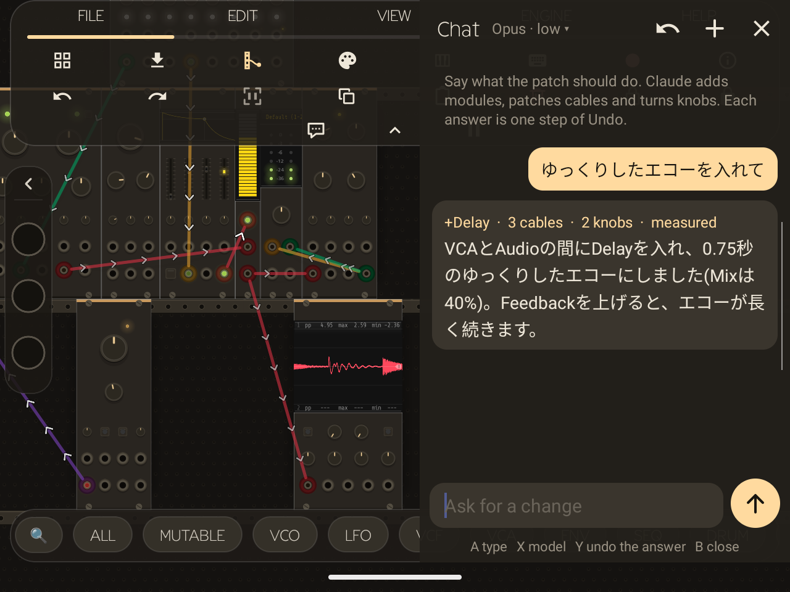

返事の先頭の橙の行が、パッチにしたことです。左のラックは、変わった場所へ自動で動きます。

チャットを開くか A を押すと、Android のキーボードが出ます。

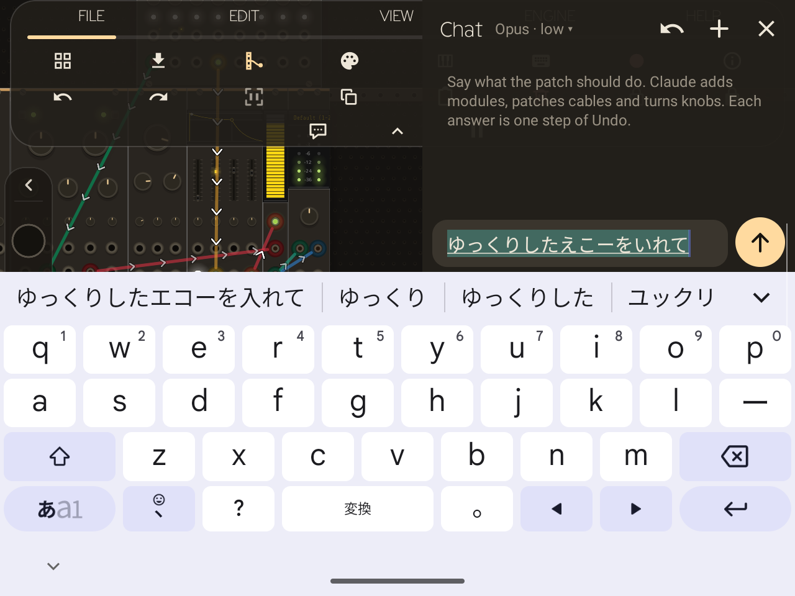

日本語を打つには、Gboard の設定 → Languages → Add keyboard で日本語を足しておきます（地球のキーで切り替え）。

| ボタン | キーボードが出ているとき | 読むとき |
|---|---|---|
| 十字キー | 文字の中を動く | ↑↓ で会話を送る |
| A | — | キーボードを出す |
| X | 読む画面へ | モデル、effort、キーボードの設定 |
| Y | 1 字消す | 答えの最中：止める。それ以外：前の答えの変更を取り消す |
| Start | 送る | キーボードを出す |
| L1 / R1 | 会話を送る | 会話を送る |
| 左スティック | 左のラックを動かす（パン） | 同じ |
| L2 / R2 | 左のラックの縮小 / 拡大 | 同じ |
| Select | 短く：一時停止 / 再生。長押し：ズームの切替 | 同じ |
| B | キーボードをしまう | 閉じる（答えの最中なら、裏で続く） |

- **1 回の依頼が、Undo 1 回**で元に戻ります。途中で止めた分も同じです。「元に戻して」と書いても戻ります。
- 指でのラックの操作は、チャットを出したままでもできます。
- つまみを選んだままチャットを開いて「これ」と書くと、そのモジュールのことだと伝わります。
- 会話はアプリを終えるまで続きます。「＋」で新しく始めます。ツールバーの南京錠をかけると、チャットからも変えられません。
- 画面に触れずに打ちたいときは、設定の Keyboard を「D-pad」にすると、十字キーで選ぶ英数字のキーボードになります。

### モデルと effort

読むときの X か、題の横の「Opus · low ▾」に触れると選べます。次の依頼から変わり、会話は引き継がれます。

| 項目 | 選べるもの | はじめの値 |
|---|---|---|
| Model | Fable / Opus / Sonnet / Haiku（それぞれの最新版） | Opus |
| Effort | low / medium / high / xhigh / max（考える長さ） | low |

### できること・できないこと

| できる | できない |
|---|---|
| いまのパッチを読む、説明する | 音を聞く（電圧を 1 秒ほど測るだけ） |
| モジュールを探す、足す、消す、複製する、動かす・並べ替える | 入っていないモジュールのダウンロード |
| ケーブルをつなぐ、抜く、つなぎ替える、重ねる | 入っているモジュールの中身を直す |
| 新しいモジュールを作る、作ったものを直す（[次の節](#モジュールを作る)） | ファイルや通信を使うモジュール |
| つまみ・スイッチ、モジュールのメニュー（モード、モデルなど）、プリセット | つまみやジャックの長押しで出るメニュー |
| バイパス、初期化、ランダム、全ケーブルを抜く | 録音、音声・MIDI・画面の設定 |
| 出力の電圧を測り、音が届いているか確かめる | プリセットの保存 |
| 自分の直前の変更を取り消す | |
| パッチの保存、別名で保存、開く、新規、一時停止 / 再生（Undo の対象外） | パッチの削除 |

- 未保存の変更があるパッチからほかを開くときは、どうするかを必ず聞きます。開く前の状態は、いつも「Last closed by chat」に 1 つ残ります。
- ファイルを選ばせるメニュー（波形の読み込みなど）は、Android の画面が出たらご自身で選びます（この動きは確かめていません）。

チャットが働くのは、RackDroid が画面に出ている間だけです。

### モジュールを作る

「こういうモジュールを作って」と頼むと、Claude が C++ で書き、Nova の中でコンパイルして試し、通ったものをそのまま使えるようにします。アプリの再起動は要りません。

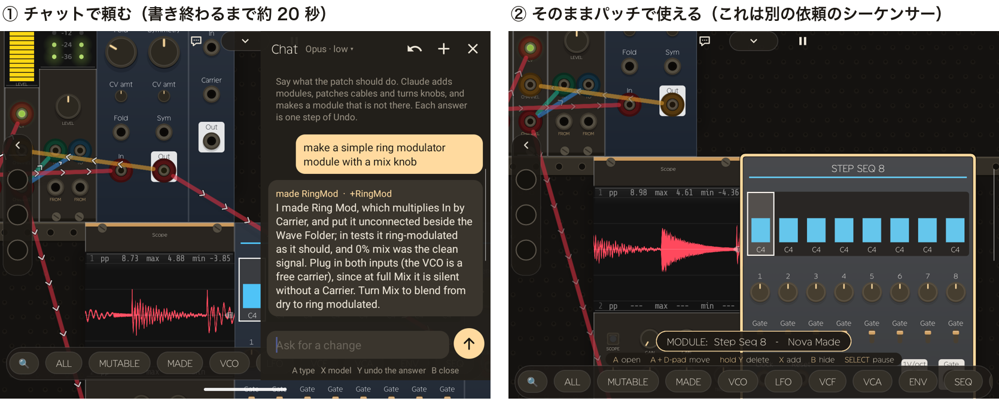

左は英語で頼んだ例です。日本語でも同じです。作ったものは一覧の「MADE」にまとまり、パッチの中では `NovaMade/名前` になります。

- **直す**：「つまみを足して」「もっと滑らかに」と書けば、動かしたまま入れ替わります。ケーブルとつまみの位置は残ります。
- **戻す**：「前の版に戻して」で戻ります。6 版まで残ります。Undo（⟲）の対象は、パッチへの追加と配線だけです。
- **止める・消す**：Start →「Made modules…」で、止める、動かす、前の版に戻す、消す、ができます。
- **やめておく**：チャットの設定の「Making modules」を off にすると、作れなくなります。

#### コードに誤りがあっても大丈夫なように

AI の書くコードには誤りがある、という前提で作っています。


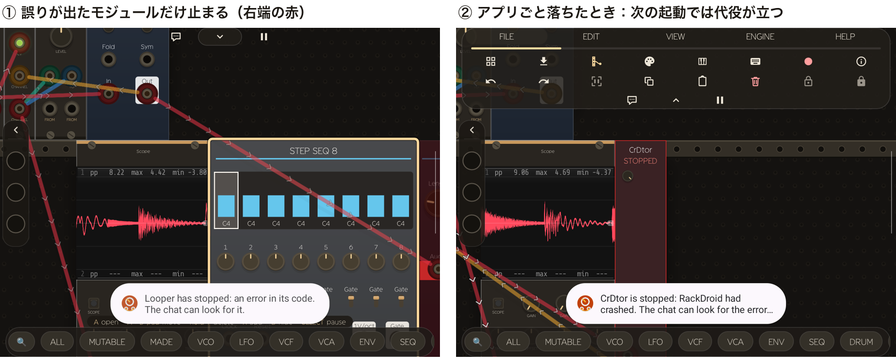

止まったモジュールは「〇〇が止まった。直して」と書けば、どの行で何が起きたかを Claude が調べて直します。

- 止まるのは、そのモジュールだけです。出力は 0 V になり、パネルに STOPPED と出ます。
- アプリごと落ちた場合も、次の起動でパッチは開きます。原因のモジュールの場所に、同じつまみとジャックの代役が立ちます。
- RackDroid を新しい版にしたあと、作り直しが要ることがあります。チャットを開くと自動で作り直します（1 つ約 5 秒）。
- 防げないもの：音が思ったとおりかどうか（Claude は音を聞けず、電圧と周波数で確かめています）。重いモジュールをいくつも置いたときの音切れ。モジュールが壊したメモリのせいで、あとから別の場所が落ちること（検査のおかげで起きにくいが、ないとは言えない）。
- 検査は、うっかりの誤りを止めるためのものです。悪意のあるコードを防ぐ壁ではありません。

#### Mac の VCV Rack で使う

Nova をつないで次を実行すると、作ったモジュールのソースを取り出し、Mac 用にコンパイルして VCV Rack に入れます（入れたら Rack を起動し直す）。

```sh
nova/tools/made-to-mac.py
```

### 仕組み

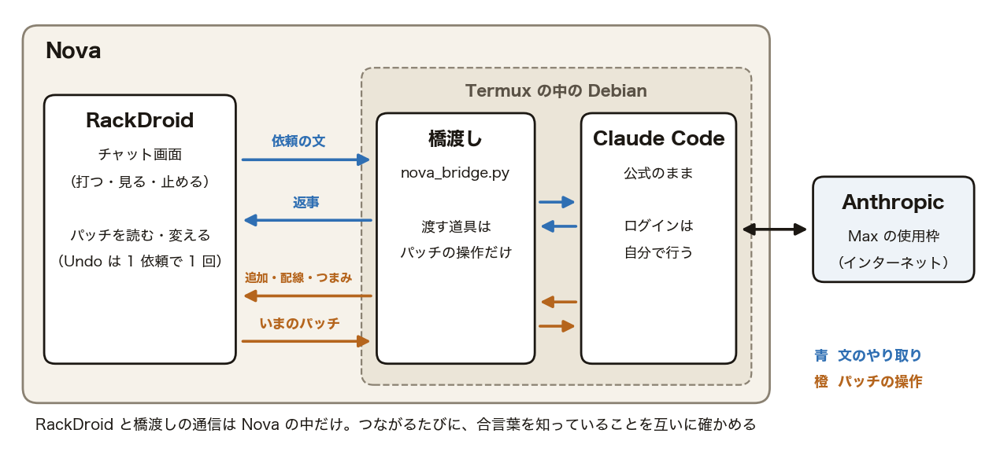

依頼とパッチの内容は、Claude Code から Anthropic に送られます。費用は、Claude Code にログインした契約（Pro / Max など）の使用枠です。API キーは使いません。

- RackDroid に Claude のログインの機能はなく、Claude Code も同梱していません。Termux に自分で入れ、自分でログインします（[Anthropic の決まり](https://code.claude.com/docs/en/legal-and-compliance)に沿うため）。
- Claude に渡す道具は、パッチの操作と、モジュールのソースを書くことだけです。ファイル、コマンド、Web は使えません。
- Claude Code は Android を公式の対象にしていません。更新で動かなくなることがあります。

### 用意（1 回だけ）

1. [Termux](https://github.com/termux/termux-app) を入れる（Play 版は機能に制限があるので、GitHub か F-Droid の版）。
2. Termux で、Debian を入れる。
   ```sh
   pkg update && pkg install proot-distro && proot-distro install debian
   ```
3. Debian に、Python と Claude Code を入れてログインする（[公式の apt の手順](https://code.claude.com/docs/en/setup)）。
   ```sh
   proot-distro login debian
   apt-get update && apt-get install -y ca-certificates curl gnupg python3
   # ここで公式の手順に従って claude-code を入れる
   claude auth login
   ```
4. RackDroid が Termux のプログラムを始められるようにする。`~/.termux/termux.properties` に次の 1 行を足し、Termux を開き直す。
   ```
   allow-external-apps = true
   ```
5. モジュールも作るなら、Termux（Debian の外）にコンパイラを入れる（約 500 MB）。
   ```sh
   pkg install clang llvm
   ```
6. RackDroid でチャットを開き、Android の許可画面で「ALLOW」を押す。これは、RackDroid が Termux の中でコマンドを実行できるようになる強い権限です。実際に始めるのは橋渡し（`nova_bridge.py`）だけで、やめるときは Android の設定で外せます。

Termux で動く橋渡しの記録は `~/nova-chat/bridge.log` に残ります。RackDroid を閉じると、橋渡しも約 2 分で終わります。

## 演奏：スティック・傾き・タッチパッドを CV に

VCV Rack 標準の「Gamepad」MIDI ドライバとして見えるので、専用のモジュールは要りません。**MIDI CC to CV** モジュールを置き、入力元に「Gamepad」→「Built-in controller」を選び、出力に下の番号を割り当てて、ケーブルでつなぎます。

| CC | 入力 | 電圧 | 使える条件 |
|---|---|---|---|
| 2 / 3 | 右スティックの左右 / 上下 | ±10 V（右・上が正） | 演奏モード |
| 15 | L3（左スティックの押し込み） | 0 / 10 V | 演奏モード |
| 21 / 22 | 本体の傾き：左右 / 前後 | ±10 V（右を下げる・奥へ倒すが正。35 度で最大） | 演奏モード |
| 23 / 24 | タッチパッドの X / Y | 0〜10 V（左→右、下→上） | パッドが出ている間 |
| 25 | タッチパッドに触れている | 0 / 10 V | パッドが出ている間 |

**演奏モード**は R3（右スティックの押し込み）で切り替えます。画面右上に緑の「PLAY」が出ます。変わるのは右スティックだけで、左スティックのパン、L2 / R2 のズーム、十字キーと A / B での操作はそのまま使えます。演奏中につまみを動かすときは、A を押して十字キーで調整します。

傾きは、演奏モードに入ったときの持ち方が中心です。取り直すときは R3 を 2 回押します。


タッチパッド（Start →「XY pad」）。指を離すとゲートが切れ、X と Y は最後の位置を保ちます。

デモパッチが入っています（Start → File… → Open）。

| パッチ | 試せること |
|---|---|
| Nova 1 - Stick CV | R3 で演奏モードにして右スティックを倒す。左右でフィルター、上下で音程 |
| Nova 2 - Tilt CV | R3 で演奏モードにして本体を傾ける。左右でフィルター、前後で音程 |
| Nova 3 - XY Pad | タッチパッドに触れている間だけ音が出る。左右で音程、上下でフィルター |
| Nova 4 - Mutable | 足した 5 モジュールを全部使った自動演奏（次の節） |

## Mutable Instruments のモジュール

### どれが Mutable 由来かを一覧で見分ける

「Mutable Instruments」は商標なので、移植版は別の名前で並んでいます（Plaits は「Macro Oscillator 2」、Rings は「Resonator」など）。名前だけでは元のモジュールが分からないので、追加の一覧に元の名前を出すようにしました。

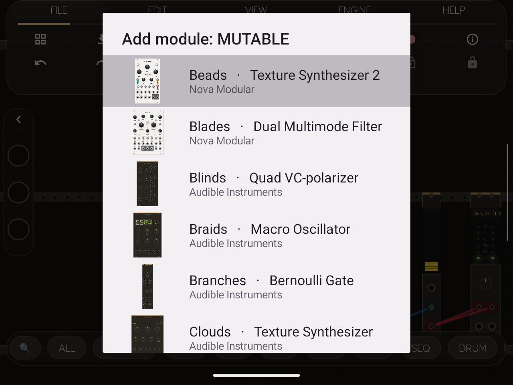

X →「MUTABLE」。入っているパック全部から、Mutable 由来のモジュールだけが元の名前の順に並びます。

- **コントローラーの一覧**（X）：いちばん上に「MUTABLE」の分類があります。行は「元の名前 · 移植版の名前」、その下にパックの名前です。ほかの分類（VCO、VCF など）では、Mutable 由来のモジュールの名前の下に「Mutable Instruments Plaits」のように出ます。
- **タッチ用のパレット**（画面下の帯）：「MUTABLE」のチップが増え、タイルの絵の下に元の名前の帯が付きます。


タッチ用のパレット。帯は MUTABLE 以外の分類（ALL や VCO など）でも付きます。

元の名前は、各モジュールの説明文（「Based on Mutable Instruments Plaits」など）から読み取っています。あとからパックを足しても、説明文にそう書いてあれば同じように出ます。

### 足した 5 モジュール（Nova Modular）

VCV の Audible Instruments（20 モジュール）にないものを、「Nova Modular」というプラグインとして同梱しました。別にパックを入れる必要はありません。

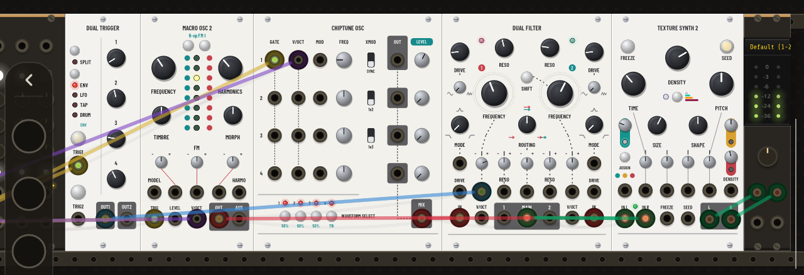

デモパッチ「Nova 4 - Mutable」を Nova で開いたところ。左から Peaks、Plaits、Edges、Blades、Beads にあたるモジュール。

| パネルの表示 | 元のモジュール | 中身 | メモ |
|---|---|---|---|
| MACRO OSC 2 | Plaits（ファームウェア 1.2） | 元のファームウェアの DSP | 24 モデル。パネル上の 2 つのボタンでモデルを送り、選んだモデルの名前がタイトルの下に出る。ポリフォニック（16 声まで） |
| TEXTURE SYNTH 2 | Beads | 元のファームウェアの DSP | 音声入力に何もつながないと、10 秒後にウェーブテーブルシンセになる（実機と同じ） |
| DUAL TRIGGER | Peaks | 元のファームウェアの DSP | エンベロープ、LFO、タップ LFO、ドラムなど 8 機能 |
| CHIPTUNE OSC | Edges | ファームウェアの再現 | 実機は 8 bit のマイコンとタイマーで鳴らすため、同じ計算と同じ表を使って作り直したもの |
| DUAL FILTER | Blades | 回路のデジタルモデル | 実機はアナログ回路 |

- **Plaits の 24 モデル**：左のボタンは緑のバンク、右のボタンは赤のバンクの中でモデルを送ります（元の 16 モデル）。後から足された 8 モデル（6 オペレーター FM、ウェーブテレイン、ストリングマシン、チップチューンなど。ランプは黄色）は、モジュールのメニューの「Model」で選ぶか、「Buttons step through all 24 models」をオンにしてボタンで順に送ります。
- **実機でボタンの長押しや同時押しで行う設定**は、モジュールのメニューにあります（フォーカスを当てて Start →「Module menu…」）。Peaks の機能（Function）、Beads の音質（Quality）、Edges の波形、Plaits の LPG の設定などです。
- **元になったもの**：5 モジュールとも [BrickRack](https://github.com/andrewfrangella/brickrack)（TrimUI Brick 用のモジュラーシンセ、GPLv3）の実装を、そのまま VCV Rack のモジュールとして動かしています。DSP は Émilie Gillet さんが公開している[ファームウェア](https://github.com/pichenettes/eurorack)（MIT、Edges は GPLv3）です。出典とライセンスは `plugin/THIRD_PARTY_NOTICES.md` にあります。

## Mac とパッチをやり取りする

パッチは Nova の `/sdcard/Android/data/org.rackdroid.test/files/Patches/` に入ります（本家はアプリの中にしまっていて、外から読めません）。USB でつなぎ、`tools/novasync` で送受信します。

```sh
nova/tools/novasync list                       # Nova にあるパッチ
nova/tools/novasync push "My Patch.vcv"        # Mac → Nova（すぐ File > Open に出る）
nova/tools/novasync pull "My Patch.vcv" out/   # Nova → Mac
nova/tools/novasync pull                       # 全部を ./patches-from-nova へ
nova/tools/novasync recordings                 # 録音した WAV を取り出す
nova/tools/novasync tags                       # モジュールのタグを取り出す（tags push FILE で送る）
```

Nova で保存したパッチは、デスクトップ版の VCV Rack 2 と同じ形式です。開く側に同じモジュール（プラグイン）が入っていれば、そのまま開けます。

- Nova で保存したパッチを Mac で開くと、Audio モジュールの出力先が未選択になります（保存されているのが Nova のオーディオ設定のため）。Audio モジュールでデバイスを選び直すと音が出ます。
- Audible Instruments のモジュールを使ったパッチを Mac で開くには、Mac の VCV Rack にも Audible Instruments が要ります（VCV Library から無料で入れられます。VCV のアカウントが必要です）。

### 足した 5 モジュールを Mac の VCV Rack にも入れる

「Nova Modular」は普通の VCV Rack 2 のプラグインとしてもビルドできます。Nova 用と同じソースです。

```sh
nova/tools/rack-sdk-from-repo.sh                                        # ビルドに使う Rack のヘッダーをそろえる
make -C nova/plugin RACK_DIR="$PWD/nova/downloads/rack-sdk" install     # ビルドして VCV Rack に入れる
```

`~/Library/Application Support/Rack2/plugins-mac-arm64/` に入り、次に VCV Rack を起動したときから「Nova Modular」のモジュールが使えます。1 行目のスクリプトは、このリポジトリにある Rack のソースと、Mac に入っている VCV Rack 2 から必要なものを集めます（先に Android 用のビルドを 1 回済ませておきます）。VCV が配っている Rack SDK を持っていれば、1 行目は要らず、`RACK_DIR` にその場所を指定します。


Mac の VCV Rack 2 で同じ 5 モジュールを動かしたところ。下の Scope は各モジュールの出力。

## ビルドと導入

Mac での手順です。Android Studio（同梱の JDK 21 を使う）と、Android SDK の NDK 27.2.12479018・CMake 3.22.1・API 35 が要ります。

```sh
export JAVA_HOME="/Applications/Android Studio.app/Contents/jbr/Contents/Home"
export ANDROID_HOME="$HOME/Library/Android/sdk"
./gradlew assembleSideloadRelease -PdevKeystore -PtestBuild
adb install -r app/build/outputs/apk/sideload/release/app-sideload-release.apk
```

`-PtestBuild` を付けると、アプリ ID が `org.rackdroid.test`（表示名「RackDroid Nova」）になり、公式版と並べて入ります。モジュールパック（`.rdmod`、本家のリリースにあります）は `/sdcard/Android/data/org.rackdroid.test/files/Modules/` に置いて再起動します。

## わかっていること・まだのこと

- Nova（Android 13）でだけ確かめています。ほかのゲームパッドは、十字キーがキーでも軸でも届くように作ってありますが、試していません。
- 音の遅れは Nova で合計およそ 50 ms です（本家と同じ。Nova が最速のオーディオ経路を許可しないため）。
- 傾きの向きと効き具合は、いまの設定でいったん確定しています（細かい調整はしていません）。
- チャットは Nova でだけ確かめています（9〜28 モジュールのパッチ）。答えるまでの時間は、質問で 1〜4 秒、変更で 6〜20 秒でした。声の入力、12 キーの日本語、長い会話、数時間の使用は試していません。チャットは Play 版のビルドには入りません（通信の権限がないため）。
- チャットでのモジュール作りは、ウェーブフォルダー、シーケンサー、リングモジュレーターなどで確かめました（頼んでから使えるまで 20〜60 秒）。長く使ったときの様子、複雑な音源や物理モデル、作ったモジュールが 10 個を超えたときは試していません。
- MIDI（USB キーボード、外部機器、Mac の DAW、Bluetooth）は本家の機能のままで、この fork では機材がなく確かめていません。
- 足した 5 モジュールは、Mac 上の検証（`nova/plugin/test/run.sh`：Plaits の 24 モデルが全部鳴ること、音程が 1 V/oct に合うこと、Peaks のエンベロープ、Blades のフィルター、Beads のグレインとシンセ）と、Nova での録音で確かめています。実機のモジュールとの聴き比べはしていません。元にした BrickRack も v0.1 です。
- 足した 5 モジュールのうち、ポリフォニックなのは MACRO OSC 2 だけです。
- 改造の中心は `native/port/{gamepad_*,transport,signal_flow,patch_ops,made_modules,module_guard}.cpp` と `app/src/main/java/org/rackdroid/{GamepadMenu,PadList,PadTextDialog,PadKeyboard,ModuleTags,TiltSensor,XyPad,MutableOrigin,ChatPanel,PatchServer,TermuxBridge,MadeModules}.kt`、チャットの橋渡しとコンパイルは `nova/bridge/`、モジュールを書くときの土台は `nova/kit/`、足したモジュールは `nova/plugin/` です。VCV Rack 本体（`third_party/`）には手を入れていません。
