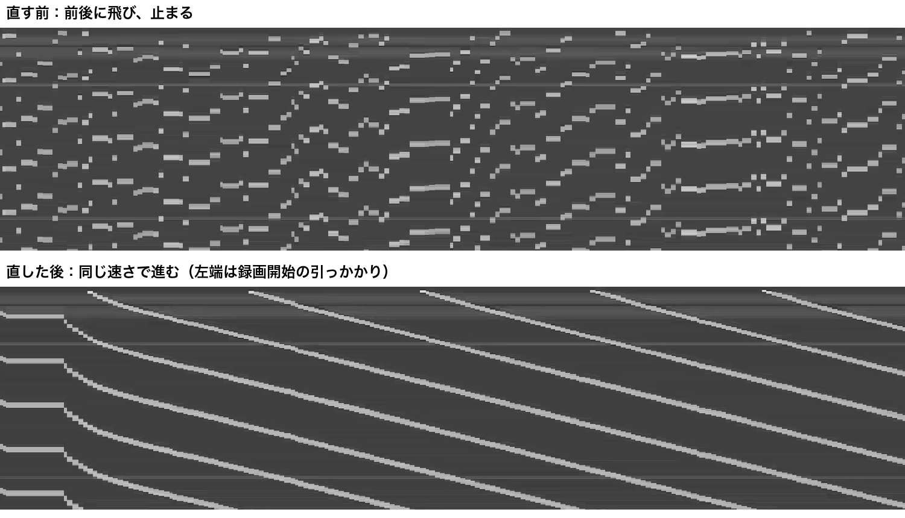
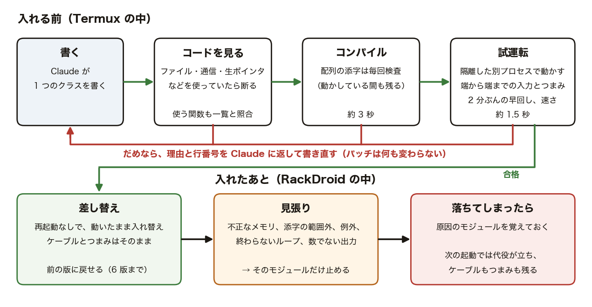

# 進み具合

## M0 準備と試用（2026-11-12 開始）

- [x] ソース取得：`nowheel/RackDroid` v0.1.3.9（+1 コミット、e2f677fb）を clone、`nova` ブランチ作成
- [x] ビルド環境：cmdline-tools（Homebrew cask）、NDK 27.2.12479018、CMake 3.22.1、platforms;android-35、build-tools;34.0.0
- [x] 公式 APK とパックを取得（`nova/downloads/`）：arm64 APK、AudibleInstruments、Valley、JW-Modules
- [x] 無改造ビルドが Mac で通ることを確認（`assembleSideloadRelease -PdevKeystore -PtestBuild`、2 分 26 秒、APK 27.7 MB）
- [x] Nova の USB デバッグを有効にして接続（adb で認識）
- [ ] 公式版を入れてタッチで試用（見やすさ、音の遅れ）
- [x] 実機の情報を採る → `device-nova.md`（十字キーは HAT 軸、L2/R2 は BRAKE/GAS、遅延はおよそ 50 ms、Exclusive は拒否）
- [x] 公式 0.1.3.9 と 3 パックを導入（パックは読み込み済みをログで確認）
- [ ] 判断：これを土台にしてよいか
- [x] 公式版をタッチで試用（2026-11-12 のユーザーの感想）
  - 本体のキーは何も効かない（想定どおり。これから作る部分）
  - 画面を動かそうとするとモジュールが動いたり、つまみに触れたりして使いにくい（画面が小さいため）→ ボタン操作を優先する根拠
  - 音は鳴る
  - 既定のパッチでは鍵盤を押しても鳴らない → 既定のパッチに MIDI→CV が無いため。`Welcome.vcv` なら鳴る
- [x] 判断：RackDroid を土台にボタン操作へ進む（2026-11-12、ユーザー了承。音の遅れは気にならないとのこと）

## M1 ソースからビルドして動かす

- [x] `-PtestBuild` で別アプリ `org.rackdroid.test`（表示名は当初 RackDroid TEST、2026-11-17 から RackDroid Nova）として Nova に導入。公式版と並んで入る
- [x] パック 3 つを `/sdcard/Android/data/org.rackdroid.test/files/Modules/` に配置
- [ ] アップデーターの停止（`.test` は別パッケージなので公式版に上書きされることはないが、明示的に止める）

## M3 ボタン操作（M2 より先に着手。タッチが使いにくいとの感想を受けて）

- [x] ① 入力の受け口（`gamepad_input.cpp`）：キーと、HAT・スティック・トリガーの軸を読む。ジョイスティックの動きがタッチ扱いされていたのを止めた
- [x] ① フォーカス移動・つまみ編集・ズーム切替・モジュール送り（`gamepad_nav.cpp`）
- [x] ② 配線（A で開始 → 反対向きのジャックだけを移動 → A で接続、B で取消・抜く）
- [x] adb からキーを送って確認：移動、編集（粗・細）、配線の開始と移動、追従スクロール
- [x] 実機のボタンで確認（2026-11-12、ユーザー「できてる」）
- [x] B でフォーカスの輪を消す。ケーブルを抜くのは Y に移動（ユーザーの要望）
- [x] ③ Start でメインメニュー、X でモジュール追加（`GamepadMenu.kt`）。追加したモジュールにフォーカスが移る
- [x] ③ メインメニューの「Module menu」でモジュール自身のメニュー（Rack のメニューがボトムシートで出る。十字キー・A・B が効くことを確認）
- [x] 別ウィンドウ（ダイアログ）にフォーカスが移ったら、押しっぱなしの状態を忘れる（`gamepadInputReset`）
- [x] メニューを開いたボタンを離すと閉じてしまう不具合を修正（実機で発覚。送ったキーは一瞬で離れるため確認で見落とした → 以後は `--longpress` でも確かめる）
- [x] メニューの各行にアイコン（ユーザーの要望）：ツールバーのアイコン、モジュールのパネル絵、波形などの記号
- [x] モジュールの移動（ユーザーの要望）：左右は隣と入れ替え、上下は段の移動、A で確定、B で元に戻す。X で追加した直後は移動モードで始まる。メニューの「Move module」でも入れる。確定後は Undo 1 回で戻る
- [x] フォーカス中のつまみが属するモジュールに薄い枠。つまみのないモジュール（Notes など）はパネル自体にフォーカス
- [x] 移動のショートカット（ユーザーの要望）：L1 / R1 を押したまま十字キーで運び、離すと確定。短く押せば従来どおり前後のモジュールへ
- [x] 本物と同じ入力での確認手段：`nova/tools/pad.sh`（コントローラーの入力ノードに `sendevent` で書く。ボタンの押しっぱなし、HAT、スティックを再現できる）
- [ ] 実機で確認（Start / X のメニュー、アイコン、モジュールの移動）
- [ ] 残り：一覧ダイアログで最初から 1 行目を選択状態にする、ツールバーを最初は畳む、アップデーターの明示的な停止
- [x] 左スティックでパン、L2 / R2 でズーム（ユーザーの要望で追加。実機での確認待ち）

## M2 スティックを CV に

- [x] `gamepad_midi.cpp`：VCV 標準と同じ ID・名前の「Gamepad」MIDI ドライバ
- [x] 演奏モード（**R3** で切替）。変わるのは右スティックだけ：CC 2/3 = 右スティック X/Y（±10 V、上が正）、CC 15 = L3（ゲート）
- [x] 左スティックのパンと L2 / R2 のズームは、どちらのモードでも常に使える
  - 2026-11-12 ユーザーの指摘で変更。当初は左スティックと L2/R2 を CV にしていたが、パンには代わりの手段がなく、つまみは A＋十字キーでも動かせるため、手放すなら右スティックのほうがよい。L2/R2 はズームのままとする（ユーザーの選択）
- [x] デモパッチ `Nova 1 - Stick CV.vcv` を同梱（右スティック左右 = フィルター、上下 = 音程）
- [ ] 実機で確認（スティックで音が変わるか、向きと効き具合）

## M4 傾きセンサーと XY パッド

- [x] 傾き（`TiltSensor.kt`）：演奏モード中だけ重力センサーを動かす。演奏モードに入った瞬間の持ち方が中心。CC 21 = 左右、CC 22 = 前後（±35° で ±10 V）
- [x] XY パッド（`XyPad.kt`）：Start → 「XY pad」で画面下に出る。CC 23 = X、CC 24 = Y（0〜10 V）、CC 25 = 触れている間のゲート。指を離しても X・Y は保持
- [x] デモパッチ `Nova 2 - Tilt CV.vcv`、`Nova 3 - XY Pad.vcv`
- [x] 確認：XY パッドは本物と同じ入力で開き、なぞると点が付いてきて音が出る・離すと止まる。傾きは、演奏モードでセンサーが登録され、解除で外れることを `dumpsys sensorservice` で確認
- [x] 実機で確認：傾きの向きと効き具合はユーザーが「現状でいったん OK」（2026-11-16）
- 作業中のパッチは `work-in-progress.vcv` として保存してからテストした

## M5 Mac との受け渡しと仕上げ（2026-11-16）

- [x] パッチの保存先を共有領域へ（`native/port/patch_share.cpp`）：`user/patches` を `/sdcard/Android/data/<アプリID>/files/Patches` へのリンクにし、既存のパッチを移した。アプリから見えるパスは変わらない
  - アプリが作るファイルは持ち主だけ読める権限（rw-------）で、adb から一覧はできても読めなかった → 起動時にグループ読み書き可へ直し、以後作るファイルも `umask(0007)` で同じにした
- [x] Mac 側のスクリプト `nova/tools/novasync`（`list` / `push` / `pull` / `recordings`）。push したファイルはアプリが上書きできるよう権限を直す
- [x] Nova → Mac：Nova で保存した `work-in-progress.vcv` を取り出し、中身が tar.zst（デスクトップ版 Rack 2 と同じ形式、Rack 2.6.4）であることを確認
- [x] Mac → Nova：Mac の VCV Rack の自動保存パッチ（Rack 2.6.6、24 モジュール、Core と Fundamental）を送り、Nova で開けることを確認（エラーの記録なし）
- [x] Mac の VCV Rack（2.6.6）で、Nova が保存したパッチ（`nova-saved.vcv`、Core と Fundamental の 6 モジュール）を開いた。ログにエラーなし、読み込み後の中身が 6 モジュール・6 ケーブルで一致（ユーザーの了承を得て実行。Mac 側の作業中パッチは置き換わった）。`work-in-progress.vcv` は Valley/Dexter を含むので、Mac 側に Valley パックが要る
- [x] メニューを開いた時点で 1 行目を選択（自前のカーソルにした。標準の選択はタッチモード中は出ないため）
- [x] 更新確認は公式パッケージ（`org.rackdroid`）のときだけ。改造版では尋ねも確認もしない
- [ ] MIDI の確認 4 通り：**保留**（2026-11-16 時点で試せる機材がユーザーの手元にない）
- [x] 使い方ドキュメント `nova/README.md`（操作の図 `nova/images/README-controls.png` は `nova/images/src/controls.py` で作り直せる。画面写真 4 枚）。ルートの README の先頭に、この fork の説明への案内を 1 段落足した
- [ ] ツールバーを最初は畳む（要望があれば）
- [x] アプリ名を「RackDroid Nova」に変更（2026-11-17、ユーザーの依頼）。アプリ ID は `org.rackdroid.test` のまま（入っているものに上書きでき、パッチと設定が残る）
- [x] 既存の機能が改造版でも動くこと（2026-11-16、実機で確認）
  - 録音：ツールバーの録音ボタンで `Documents/RackDroid/` に WAV（ステレオ 16 bit 48 kHz）ができる
  - 画面オフ再生：自動で鳴るデモを録音しながら画面を 7 秒消した。13 秒の録音の全区間で音量が一定（無音の秒なし）
  - 画面の鍵盤：`Welcome.vcv` で鍵盤を 2 回押すと、押している間だけ録音に音が入る
  - タッチ：ツールバー、メニュー、パッチを開く操作、XY パッドはタッチで操作して確認済み
- 傾きセンサーの向きと効き具合は、ユーザーが実機で触って「現状でいったん OK」（2026-11-16）

## M6 足りないモジュールと、Mutable 由来の表示（2026-11-17）

ユーザーの依頼：M6 をやる。足したモジュールは VCV Rack でも使えることが前提。モジュールを足すときの一覧で、どれが Mutable Instruments 由来か分かるようにする。

- [x] プラグイン「Nova Modular」（`nova/plugin/`）：Beads、Peaks、Edges、Blades、Plaits（ファームウェア 1.2 の 24 モデル）
  - brickrack（0.1.0、49b726c）のモジュール 5 つと枠組みを**無改造で**取り込み、VCV Rack の Module / ModuleWidget に包む層（`src/adapter.cpp`）を書いた。パネルは brickrack のパネル定義から描く（SVG なし）
  - ファームウェアは `pichenettes/eurorack`（f4cfa76）と `stmlib`（e3bd7c9）から、使うファイルだけを `nova/plugin/eurorack/` に置いた。変更は 1 か所（Beads のデバッグ用 printf を外した）。`third_party/` には触れていない
  - brickrack のエンジンは 48 kHz 固定で、Plaits と Peaks の包みはそれを前提にしている → この 2 つは 48 kHz で動かし、エンジンのレートが違うときは変換する
  - Plaits はポリフォニック（チャンネルごとに 1 声、16 声まで）
  - 実機でボタンの長押し・同時押しで行う設定（brickrack の「隠しパラメーター」）は、モジュールのメニューに出す。RackDroid のメニューはスライダーを出せないので、連続値は段階の項目にした
- [x] Nova 用：アプリに同梱（`libplugin_nova.so`、APK は +0.8 MB）。CMake は `nova/plugin/plugin.cmake`、既存ファイルの変更は呼び出し口だけ
- [x] Mac の VCV Rack 2 用：同じソースを `nova/plugin/Makefile` でビルド。Rack SDK はダウンロードせず、リポジトリ内の Rack のヘッダーと Mac の VCV Rack から組み立てる（`nova/tools/rack-sdk-from-repo.sh`）
- [x] 一覧での表示（`MutableOrigin.kt`）：元の名前を各モジュールの説明文から読み取る。コントローラーの一覧に「MUTABLE」の分類（元の名前順）と、ほかの分類での注記。タッチ用パレットに「MUTABLE」のチップと、タイルの下の帯
- [x] デモパッチ `Nova 4 - Mutable.vcv`（5 モジュールを全部使った自動演奏）
- 確認したこと
  - Mac 上の検証（`nova/plugin/test/run.sh`）：Plaits の 24 モデルが全部鳴る、0 V で C4・1 V で C5、Edges が 1 V で 1 オクターブ上がる、Peaks のエンベロープがゲートに従う、Blades のカットオフで高域が変わる、Beads のグレインと 10 秒後のシンセ。全項目通過
  - Mac の VCV Rack 2.6.6：プラグインが読み込まれ、5 モジュールが Scope に波形を出す。3 音の和音を入れると Plaits の出力がポリフォニックになる。Nova で保存したパッチ（5 モジュール入り）がエラーなしで開く
  - Nova：一覧に MUTABLE（27 モジュール）が出る。デモパッチを録音すると、0.5 秒ごとのステップと、メロディの音（G3、A#3 など）・1 オクターブ下の Edges が入っている。エンジンを 44.1 kHz にしても同じ音程。音切れなし（負荷は 1 スレッドで 30〜35%）。モジュールのメニューから Peaks の機能を LFO に変えると、パネルの表示とランプが変わる
- まだのこと：実機のモジュールとの聴き比べ。MIDI は引き続き保留

## 操作まわりの改善 7 件（2026-11-24、ユーザーが実機で触った感想から）

- [x] **モジュール選択**：つまみで B を押すとパネル全体を選ぶ段階に上がる（もう一度 B で枠を消す。ユーザーの選択）。十字キーで隣のモジュール、A でつまみに入る。画面下に、いまの場所でのボタンの働きを 1 行で出す（L1 / R1 を押したまま動かせることに、使っていて気づけなかったため）
- [x] **削除**：モジュール選択中に Y を 0.5 秒押し続ける（ユーザーの選択）。Undo 1 回でケーブルごと戻る
- [x] **移動**：モジュール選択中に A を押したまま十字キー
- [x] ツールバーの南京錠がコントローラーの操作にも効くようにした（いままでは無視していた）
- [x] **一覧が先頭に戻る不具合**：カーソルのたびに `notifyDataSetChanged()` を呼んでいたのが原因。ListView 自身の選択（0 行目）を基準に作り直され、そこからスクロールし直していた。行を塗り替えるだけにした
- [x] **検索とタグ**（`ModuleTags.kt`、`PadTextDialog.kt`、`PadKeyboard.kt`、`PadList.kt`）：十字キー用のキーボードと Android のキーボードの両方で打てる（ユーザーの選択）。自分のタグ、Rack のタグの日本語の言い換え、VISUAL の分類
- [x] **一時停止**（`transport.cpp`）：Select（ユーザーの選択。ズームの切替は Select の長押しへ）、メニュー、ツールバーの矢印の横。エンジンごと止める
- [x] **音の流れ**（`signal_flow.cpp`）：ケーブルの上を矢印が流れる。選んだモジュールに入るものは青、出るものは橙
- 確認したこと（Nova の実機、`pad.sh` の入力と画面写真）
  - 一覧：直す前の版で不具合を録画して再現 → 直した版で同じ手順を録画し、先頭に戻らないこと。押しっぱなし、ページ送り、上方向も
  - モジュール選択：移動と削除が Undo 1 回ずつで戻る。全モジュールを続けて消しても落ちない。つまみのないパネル、南京錠、L1 の移動
  - 一時停止：録音しながら 4 秒止めると、その 4 秒が省かれ、継ぎ目に無音の穴もクリックもない。停止中の画面オフ、90 秒停止後の再開で自動調整が動かないこと、パッチを開くと再生に戻ること。停止中はエンジンのスレッドが CPU を使わない
  - 音の流れ：24 モジュールのパッチを縮小表示で、描画スレッドの CPU は表示あり 54 / 40 / 33 %、なし 54 / 36 / 33 %（3 秒ずつ 3 回）
  - 検索：コンパイルしたクラスを Mac の JVM で動かし、145 モジュールに日本語を含む語で当たり方を確かめた（「波形」「可視化」「オシロ」「ｵｼﾛ」の先頭が Scope）。実機では十字キーと Gboard の英字、日本語のタグの表示と付け外し、アプリを入れ直したあとも残ること、タッチのパレットの検索
  - 既存機能：録音、画面オフ再生（12 秒の録音で無音の秒なし）、演奏モードの切替、XY パッドと鍵盤が開くこと、タッチのツールバー
- まだのこと：ユーザーの実機での感想。実機の Gboard で日本語を変換して打つこと（自動では試せない）。演奏モードのゲートと CV、鍵盤の音は今回鳴らして確かめていない。MIDI は引き続き機材待ち。Mac の VCV Rack で開くことは確かめていない（パッチの形式には触れていない）

## チャットでパッチを組む（2026-11-25、ユーザーの依頼）

ユーザーの依頼：アプリ上のチャットでモジュールを追加したり配線したりしたい。できるだけサブスクの枠で。Nova だけで。

- 方法の選択：①API を直接呼ぶ（Max に付く月 $100 のクレジット）、②Mac の Claude Code、③Nova の Termux で Claude Code を動かす。ユーザーが③を選んだ。公式の規約では、アプリに Claude のログインを付けたり Claude Code を同梱したりできないので、Termux に自分で入れてログインする形にした
- [x] **操作の受け口**（`patch_ops.cpp`、`PatchServer.kt`）：描画スレッドで 1 つずつ実行。1 依頼 = Undo 1 回。通信は `127.0.0.1:38470` だけで、つながるたびに HMAC で合言葉を互いに確かめる（合言葉そのものは送らない）。チャットを開くまで待ち受けない
- [x] **橋渡し**（`nova/bridge/nova_bridge.py`、Python の標準ライブラリだけ）：Claude Code を 1 つ動かし続け、毎回いまのパッチを添えて渡す。道具は 11 個で、`--tools ""` と `--strict-mcp-config` によりそれ以外は使えない。1 回の呼び出しで複数のモジュール・ケーブル・つまみを扱えるようにして、同じ依頼が Sonnet で 31 → 15 秒、Opus で 37 → 20 秒になった
- [x] **チャット画面**（`ChatPanel.kt`）：十字キー用と Android のキーボード。止める、取り消す、閉じても続く。変わった場所へ画面が動く（`gamepadNavShow`）
- [x] **自動起動**（`TermuxBridge.kt`）：Termux の RUN_COMMAND で、アプリに同梱した橋渡しを渡して始める。権限はユーザーが自分で許可した
- [x] **モデルと effort の選択**（`ChatSettings.kt`、ユーザーの指摘）：Fable / Opus / Sonnet / Haiku、low〜max。会話を引き継いで切り替わることを、Claude Code の記録に残ったモデル名で確認（`claude-fable-5-2`、`claude-opus-5-5`、`claude-sonnet-5-5`、`claude-haiku-5-5`）。答えの最中に変えると、終わってから切り替わる
- [x] **Android のキーボードを標準に**（ユーザーの依頼）：開いたときと A で出る。十字キーのキーボードは設定で選ぶ。Nova の Gboard には英語しかなかったので、日本語（12 キーと QWERTY）を足した。QWERTY で変換して送り、日本語の返事まで確認
- [x] 直した不具合：アプリを入れ替えた直後、前の橋渡し（古い版）がつなぎ直して答え続けることがあった。橋渡しを、それを始めたアプリの起動（instance）に結び付け、違うものは断る
- モデルの既定は Opus（低い effort）。1 つの依頼での比較では、Opus は音量を測って自分で直し、Sonnet は 5 秒ほど速く、Haiku は引用符の取り違えでやり直しが多かった
- 確認したこと（Nova の実機）
  - AI を使わずに全操作：追加、配線、重ね、付け替え、抜き、つまみ（数値、文字、範囲外）、削除、測定、誤った指定。Undo 1 回でケーブルもつまみも元と一致
  - 合言葉を知らない接続と HTTP の接続は、何も渡さずに切れる
  - 実際の依頼：リバーブ、左右の揺れ、ベースライン、エコー、コーラス、ドラム（途中停止）。チャットの undo、画面の Undo / Redo が依頼ごとにまとまる
  - 南京錠、一時停止、画面オフ（あとから勝手に実行されない）、アプリの再起動、橋渡しの強制終了（次の一言で立ち上がり、会話が続く）、両方のアプリを止めた状態からの起動、Termux の許可がないときの案内、アプリを閉じて約 2 分で橋渡しが終わること
  - 重いパッチ（28 モジュール、音声処理は平均 72%）でチャットを使っても、音切れの記録なし
  - 既存の操作：フォーカスの移動、モジュール選択、メニュー、一時停止、XY パッド
- まだのこと：ユーザーの感想。声の入力、12 キーの日本語。モジュールのメニュー、移動、保存などはチャットからできない（README の表）。長い会話、数時間の使用、Nova の再起動後（Termux を開かずにチャットから始まるはず）。使用枠を使い切ったときの表示。Mac の VCV Rack で開くこと（パッチの形式には触れていない）

## チャットの操作を足す、音の流れを滑らかに、新しいモジュールの調査（2026-11-25、ユーザーの依頼）

- [x] **モジュールのメニュー**：Rack のメニューを画面に出さずに組み立て、行に番号を付けて読み、選ぶ。プリセットも同じ。変わった中身は Undo に入る。143 モジュール全部のメニューを読んで失敗なし
- [x] **バイパス、初期化、ランダム、複製、全ケーブルを抜く、移動**：どれも依頼ごとに Undo 1 回。元と一致することを確認
- [x] **保存、開く、新規、一時停止**：未保存なら断って聞く。開く前の状態は必ず「Last closed by chat」に残す。Rack は「Save a copy」を保存済みとみなすため、テスト中に確認なしで別のパッチが開いた（中身は同じ内容のコピーがあり失われていない）。それで必ず残すようにした
- [x] **音の流れの矢印**：位置を毎フレーム計算し直していて、信号の強さで間隔が少し変わるだけで列が飛んでいた。ケーブルごとに位置を覚えて進める形に変更。強さの変化もならし、両端で大きさを変える
- [x] **放置中の描画**：5 秒触らないと、画面更新の待ち時間まで処理の重さに数えて、数コマごとに 70 ms 休んでいた（平均 35 fps、最大 100 ms）。矢印が動いている間は、軽いコマなら毎回描く。60 fps で揺れなし（28 モジュールでも。音切れなし、温度の警告なし）。アプリの CPU は 9 モジュールで 1 コアの 56% → 74%

ケーブル 1 本の上の矢印の位置（縦）と時間（横、3 秒）。録画から取り出したもの。

**新しいモジュールを作れるか**（試作して確かめ、終わったあと消した）

- Nova だけで作れる。Termux のコンパイラ（clang 21）で、折り返し歪みのモジュールを 1 から書いて 1.4 秒でコンパイルし、`.rdmod` にして RackDroid に読み込み、パッチの中で音を通した。要るのは Rack と OpenGL のヘッダー（2 MB 強）と、アプリの中の `librack_engine.so`・`libc++_shared.so` だけ
- 同じソースは Mac の VCV Rack 2 用にもコンパイルできた（Mac の Rack での動作はまだ）
- 既存のモジュールの編集：ソースはリポジトリの `third_party/` にある。パック（AudibleInstruments、Valley、JW-Modules）は直した版に差し替えられるが、同梱のもの（Fundamental、Drums、Nova Modular、Core）は同じ名前では差し替えられない（読み込み済みの名前は飛ばされる）。別の名前の複製として作るのがよい。差し替えると、Mac の同じ名前のモジュールと音が変わる
- 注意：モジュールは機械語で、誤りがあるとアプリごと落ちる。読み込み済みのものを直した版に替えるには、アプリの再起動が要る
- チャットから作る機能はこのときはまだなかった（次の節で足した）

## チャットからモジュールを作る（2026-11-25、ユーザーの依頼：「コードに誤りがあることも想定して」）

- [x] **土台**（`nova/kit/nova_kit.hpp`、`nova_kit_impl.hpp`）：書くのは 1 つのクラス（コンストラクタと `process()`）だけ。パネルの配置と描画、メニュー、パッチに残す値、誤りの扱いは土台の側。Mac の VCV Rack でも同じソースが動く
- [x] **コンパイルと試運転**（`nova/bridge/nova_build.py`、`nova/kit/test.cpp`）：ヘッダーとライブラリは RackDroid の APK から取り出す。①禁止語（#include、new、ポインタのキャスト、スレッド、ファイル、APP など）②`-Wunsafe-buffer-usage` で生のポインタと C の配列を断る ③オブジェクトファイルが求める関数を一覧と照合 ④ASan と UBSan を付けた版を、別プロセス（seccomp で書込み・通信・別プロセスの起動を禁止）で 3 つのサンプルレートで数十通り動かす ⑤本番の版で速さと 2 分ぶんの早回し、頼まれた測定（probe）。4.5 秒
- [x] **本番の版にも検査を残す**：libc++ の検査（vector / array の添字）と `-fsanitize=bounds`。1 か所ずつ別の命令にして（`__assertion_handler`）、どの行かわかるようにした
- [x] **見張り**（`native/port/module_guard.cpp`）：SIGSEGV / SIGBUS / SIGFPE / SIGILL / SIGTRAP / SIGABRT と、終わらないループ（1.5 秒、描画は 0.45 秒）から `siglongjmp` で戻る。費用は 1 回 9 ns
- [x] **差し替え**（`native/port/made_modules.cpp`）：Rack から見たモデルは 1 つのまま、中のコードだけ替える。パッチのモジュールを抜いて、同じ ID・位置・つまみ・ケーブルで戻す。再起動なし
- [x] **落ちたとき**（`MadeModules.kt`）：見張りの外で落ちたら、スタックにあった作りもののモジュールを記録してから落ちる。次の起動では、同じつまみとジャックの代役が立つ。読み込み中に落ちた場合、2 回続けて起動に失敗した場合も同じ
- [x] **画面**：チャットの途中経過（Writing / Compiling and testing / Putting it right）、Start →「Made modules…」、一覧の MADE、パネルの絵、チャットの設定の「Making modules」
- [x] **Mac 用**：`nova/tools/made-to-mac.py`
- 確認したこと（Nova の実機）
  - わざと壊した 44 種を試運転に流し、すべて理由を付けて断った（場所がわかるものは行つき。範囲外、負の添字、null、0 除算、NaN、発散、無限ループ、無限再帰、解放後の参照、例外、メモリの使いすぎ、遅すぎ、ファイル、通信、スレッド、パネルに入りきらない、など）。正しいものは通った。毎回メモリを確保するだけのものは断らずに注意を返す作りで、試した 1 つは最適化で確保が消えて通った
  - 隔離：試運転の中からの書込み、ソケット、fork、exec、削除がすべて拒否されること（proot の中と外で）
  - 試運転をすり抜ける誤りを 12 種作って本番で起こした：例外、範囲外、null、abort、スタックあふれ、NaN、無限ループ（音と描画）、描画中、コンストラクタ、デストラクタ。全部そのモジュールだけが止まり、アプリと音は続いた（デストラクタは最初はアプリごと落ちた。代役が立つことを確かめたうえで、これも止まるだけにした）
  - 62 秒後に範囲外になるループの例：止まったあと、チャットが 18 秒で原因の行を見つけて直し、つながったまま動いた。この例は、あとから足した 2 分の早回しで作る前に見つかるようになった
  - チャットで作ったもの：ウェーブフォルダー（51 秒）、8 ステップのシーケンサー（57 秒）、リングモジュレーター（23 秒）。どれも 1 回目で合格。つまみの追加とパネルの色の変更は 16 秒
  - 途中で止めると入らないこと、前の版に戻すこと、差し替えをまたいだ Undo / Redo、止めて動かしてもメニューとつまみが残ること、コンパイラがないときの案内、ヘッダーが変わった版での自動の作り直し
  - コンパイルの間の音切れなし
  - Mac の VCV Rack 2：4 つとも読み込み、Nova で保存したパッチ（Rings を除いたもの）を開いて、モジュール、つまみ、メニューの値、ケーブルが残ること、パネルの絵
- 直した不具合：依頼の番号とモジュールの ID が同じ欄だった。消して同じ名前で作り直すと前のライブラリが読まれて失敗した。前回「消した」と書いた試作パック（NovaScratch）の展開された写しが Nova に残っていたので、モジュール管理から消した
- 試験で作ったモジュールとパッチは全部消し、開いていたパッチは試験前と同じ（つまみとケーブルを照合）
- まだのこと：ユーザーの感想。長時間の使用。複雑な音源。入っているモジュール（Fundamental など）のソースを読んで直すことはできない。ファイルを読むモジュール（サンプラーなど）は作れない。指で触れる画面のあるモジュール（XY やステップを叩く）は土台にまだない

## チャットを出したままのパンとズーム（2026-11-25、ユーザーの依頼）

- [x] 左スティックでパン、L2 / R2 で縮小 / 拡大、Select の長押しでズームの切替（チャットを出していないときと同じ）。キーボードが出ていても効く。拡大の中心は、チャットとキーボードに隠れていない部分の真ん中
- 仕組み：チャットは別のウィンドウなので、ジョイスティックの値を `ChatPanel` が受けて `gamepad_nav` に渡す。Android は使われなかったスティックを十字キーに変えて送ってくる（これまで左スティックで会話が動いていたのはそのため）ので、十字キー（HAT）が倒れていないものは捨てる。ウィンドウがフォーカスを失ったら、スティックは戻ったことにする
- 確認したこと（Nova の実機、`pad.sh` の入力）：キーボードが出た状態での左右・上下のパン、拡大、縮小。B でキーボードだけがしまわれること
- 左スティックで会話が動かないこと、Select の長押し、スティックを倒したまま閉じたときは、次の節の作業で確認した

## チャット中の操作を制限しない、演奏モードの割り当て、履歴、モジュールの呼び名（2026-11-25、ユーザーの依頼）

- [x] **コントローラーはラックのまま**：チャットのウィンドウを、打つ・読むとき以外はフォーカスを取らない（`FLAG_NOT_FOCUSABLE`）ものにした。キーもスティックも、チャットがないときと同じ道を通る。Start の長押しでチャットとラックを行き来する（そのため Start のメニューは、離したときに開くように変えた）。チャットにいる間も、両スティック、トリガー、L3、R3、Select はラックに渡す。名前の帯と操作の案内は、チャットに隠れない幅に収める
- [x] **演奏モードの割り当て**（`patch_ops.cpp` の `controls`、橋渡しの `play_controls`）：Core の MIDI CC to CV をコントローラー用に設定して足す（あれば使い回す）。読むときに、どの出力がどの操作かを添える
- [x] **履歴**（`ChatStore.kt`）：会話を 1 つずつファイルに残す。Claude Code の会話の番号も覚え、起動し直しても `--resume` で続ける。番号が Claude 側にないときは、その旨を出して新しく始める
- [x] **モジュールの呼び名**：パネルの名前で呼ぶように指示した（元の実機の名前では画面に見つからない、というユーザーの指摘）
- [x] 直した不具合：画面に触れたあと、メニューで最初に押した十字キーが効かなかった（Android がフォーカス探しに使う）。題にフォーカスを持たせて解消
- 確認したこと（Nova の実機、`pad.sh` の入力）
  - チャットを出したままのフォーカス移動、編集、右スティック、メニュー、入力中のパン・ズーム・右スティック・演奏モード・L3。Start の長押しでの行き来、B の長押しで閉じる。スティックを倒したままの行き来で値が残らないこと
  - 頼んだ割り当て（音程、フィルター、L3、傾き）を 52 秒で組み、R3 のあとのスティックと L3 の入力で電圧が動くことを測った（傾きは小さな揺れだけ）。取り消して、パッチとつまみが元どおりなことを照合
  - 履歴：アプリを終了して続きを話す、別の会話との行き来、消す、Claude 側の記録がないとき
- 使用中のパッチは `backup-20261125-dub` としてコピーを残してから確認した
- まだのこと：傾きを実際に傾けて演奏すること、XY パッドとの組み合わせ、ユーザーの感想

## 演奏モードの操作を増やす：Nova Play（2026-11-25、ユーザーの依頼）

ユーザーの決定：使う操作だけ演奏に回す／ボタン・トリガーと左スティック・本体の動き・タッチ・キーの組み合わせを全部／専用モジュール／つまみの直結も。

- [x] CC を増やす（`gamepad_midi.cpp`）、使っている操作を調べる（`play_claims.cpp`）、演奏中はラック側で無視する（`gamepad_nav.cpp`）
- [x] **Nova Play**（`nova/plugin/src/play.cpp`）：名前付きジャック 48 個とスロット 8 個（組み合わせ、動き方、幅、つまみの直結）
- [x] ひねりと振り（`MotionSensor.kt`）、2 本指（`XyPad.kt`）、ドラムパッドとフェーダー（`PlayPads.kt`）、R3 で自動表示
- [x] AI：`play_controls`（Nova Play）と `play_assign`（スロット）
- 確認したこと（Nova の実機、`pad.sh` の入力と電圧の測定）：演奏モードの入／切での L2・A・左スティック・十字キー・右スティック、L1＋A、L1＋右スティックで保つ、B で切替、R2 でつまみを動かして戻る（手で動かした位置が新しい基準になる）、ドラムパッド 1 と強さ、センサーの登録、パッドの自動表示。パッチは Undo で元どおり（つまみ 1191 個とケーブルを照合）。Mac の VCV Rack で読み込みとパネルの絵
- まだのこと：AI に実際に組ませる試験、振る・ひねる・2 本指を手で、途中で保存して開き直したときの直結の基準、Mac でゲームパッドをつないだ動作、`Nova 1〜3` の同梱パッチの再確認、`nova/images/src/controls.py` の図の更新

## 公開

- 2026-11-12：ユーザーの依頼で、GitHub に fork を作って `nova` ブランチを push した（https://github.com/jhorikawa/RackDroid 、本家 `nowheel/RackDroid` の fork、公開）。計画では「push しない」としていたが、これで変更。以後も push は依頼があったときだけ行う
- リモート：`origin` = 自分の fork、`upstream` = 本家
- GitHub の既定のブランチは `nova`（リポジトリを開くと改造版が見える）。`main` は本家と同じ内容のまま残し、`nova` をマージしない。本家の更新は `main` に取り込んでから `nova` に反映する
